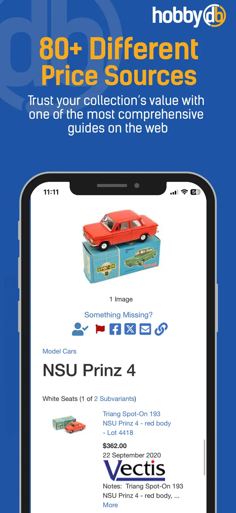
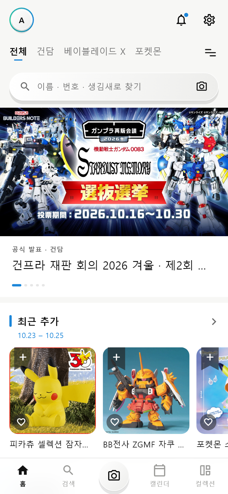
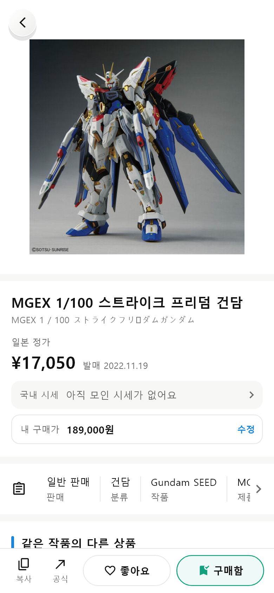
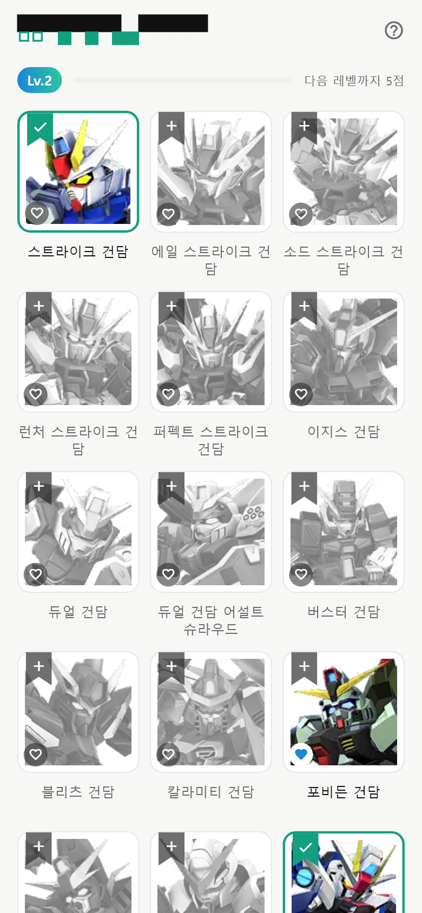
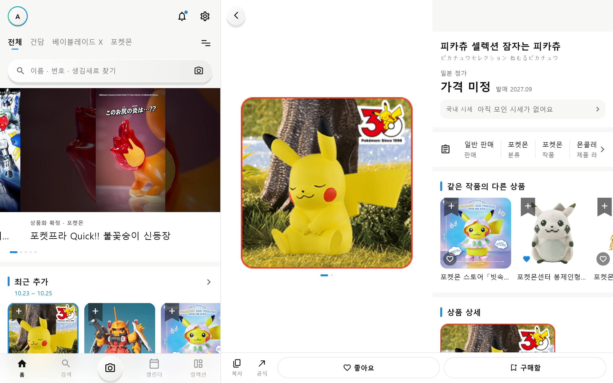

# Gunpula v2 — hobbyDB v2 재설계 · GAI3008 중간프로젝트 저장소 (1인 1팀)

## 앱 소개

> 앱스토어 상품 페이지처럼 채웁니다. 칸 이름과 순서는 발표 자료의 "앱 소개" 장과 같습니다.

### 앱 이름
Gunpula v2 (임시 이름 — hobbyDB v2 재설계)

### 부제
내 IP의 새 소식부터 내 컬렉션 도감까지, 수집가를 위한 한 앱

### 카테고리
라이프스타일 (수집 · 취미)

### 대상 사용자 / 사용 상황
- 대상 사용자: 건프라 · 베이블레이드 X · 포켓몬 피규어를 모으는 20대 수집가 (퍼소나 "민준, 23, 수집 4년차" — `docs/기획.md` 2장)
- 사용 상황: 등하굣길 폰으로 재판 · 신상 소식 확인 → 매장에서 카메라 · 바코드로 찾기 → 집에서 폴드를 펼쳐 컬렉션 · 도감 정리 · 동생과 겹쳐 사지 않게 확인

### 스크린샷
이미지는 `docs/screenshots/`(v2 화면은 `flutter test tool/screenshots_test.dart`로 다시 만들 수 있음).

| v1 현행 | v2 홈 | v2 상품 상세 | v2 도감 | v2 넓은 화면 (반반) |
|---|---|---|---|---|
|  |  |  |  |  |
| 웹 메뉴 그대로 · 경매 기록 · 버튼이 한꺼번에 | 내 채널의 공식 예고 배너 + 가로 줄, ♡ · 리본 바로 담기 | 일본 정가 · 국내 시세 한 줄 · 아래 고정 ♡ 좋아요 · 리본 구매함 | 흑백 → 컬러 → 초록 테두리 → 내 사진 고리, 작품 Lv | 폴드 · 태블릿: 왼쪽 앱 그대로, 오른쪽 상세 |

### 설명
1. 관심 있는 IP(채널)만 골라 **공식 예고 · 발매일 · 새 상품**을 먼저 보고, 갖고 싶은 것은 ♡, 산 것은 리본으로 한 번에 기록하면, 모을수록 **도감 칸에 불이 켜지고 레벨이 오르는** 수집 앱입니다.
2. 현행 hobbyDB는 웹사이트 메뉴를 그대로 옮겨 익히기 어렵고(2023-11-23 ★5 · 2023-04-18 ★5), 스캐너가 멈추고(2025-07-28 ★3), 시세를 한 달 10번만 보게 막고 광고가 많습니다(2025-11-30 ★1). v2는 "내 채널"과 "수집가가 하는 일의 순서"(소식 → 찾기 → 판단 → 기록 → 보기 → 나누기)로 화면을 다시 짰습니다.
3. 핵심 가치: 내 채널 소식 · 한 번에 기록(♡ · 리본) · 도감 레벨 · 친구와 나누기(겹쳐 사지 않기 · 게시물 · 워터마크) · 폰부터 폴드까지 같은 앱.

### 새로운 기능
v2에서 바뀐 것 — 원칙 카드(`docs/원칙카드.md`)의 P번호와 연결합니다.

| P번호 | 바뀐 것 (화면 · 요소 번호) | 근거 (리뷰 · 원칙) |
|---|---|---|
| P04 | ♡ = 좋아요 · 리본 = 구매함을 모든 화면에서 같은 모양으로, 앱 전체가 한 벌로 같이 바뀜 (A-9 · G-4b · D-6 · S-16) | 2023-11-23 ★5 "쇼케이스와 컬렉션의 차이를 모르겠다" |
| P07 | 사진 위에서 바로 담기 · 시세 횟수 제한 없음 · 카메라 지름길 (A-9 · D-5b · S-4) | 2025-11-30 ★1 "시세를 한 달 10번만" |
| P01 | 도감 4단계 + 작품 Lv · 분석 중 표시 · 안 읽은 알림 (G-4 · G-4a · E-4 · N-3) | 2025-07-28 ★3 스캐너가 멈춰도 알 수 없음 |
| P03 | 모든 켜고 끄기에 되돌리기 · 휴지통 · 새 창 대신 같은 탭 안 보기 (F-10 · O) | 2023-04-18 ★5 "누를 때마다 다른 창" |

### 평가 및 리뷰
| 항목 | 내용 |
|---|---|
| 현행 별점 | ★ 4.8 (App Store, 8,656개 — ★5 7,690 · ★4 460 · ★3 159 · ★2 70 · ★1 277) |
| 리뷰 수 | 스토어에 보이는 리뷰 8개를 유형별로 분류 — `docs/기획.md` 1-3 |
| 대표 리뷰 | "the layout is a pain" — ★5 · 2023-04-18 / "TOO MANY ADS ON ONE SCREEN" — ★1 · 2025-11-30 (**작성자 이름 지움**) |
| 출처 | [App Store — hobbyDB: Collection Management](https://apps.apple.com/us/app/hobbydb-collection-management/id1537173276) · 2026-10-26 확인 |

---

## 작성자 · 제출 정보

| 칸 | 내용 |
|---|---|
| 현행 앱 | [hobbyDB: Collection Management](https://apps.apple.com/us/app/hobbydb-collection-management/id1537173276) |
| v2 한 문장 | 내 IP 채널의 새 소식과 내 컬렉션(좋아요 · 구매함 · 도감)을 한 앱에서 보고, 친구와 나누는 수집 앱 |
| 작성자 | TODO: 이름(또는 이니셜) · 1인 1팀 |
| 데모 | TODO: 데모 영상 1분 `docs/영상/demo_1min.mp4` 또는 드라이브 링크 — **제출물 ①에 필수** (녹화 순서: 6장) |
| AI 사용 | 규칙 `AGENTS.md` · 기록 `docs/prompt-log.md` · 셀프 논증 `docs/셀프논증.md` · 기획 확정 태그 `v1-plan` |
| 발표자료 | `docs/발표/Gunpula_v2_발표.pptx` (교수 템플릿 v1.1.0 바탕) |

> 이 저장소는 **UI만 구현**합니다(중간고사 안내문 5장). 보이기는 다 동작하는 것처럼, 실제 동작(저장 · 로그인 · 결제 · 실제 인식 · 실제 계산)은 없습니다.
> 화면 16개: S 앱 셸 · C 채널 바 · A 홈 · B 검색 · O 전체 목록 · D 상품 상세 · E 찍어서 찾기 · H 캘린더 · F 컬렉션 · G 도감 · J 공식 예고 · M 친구 서랍 · I 내 정보 · L 친구 컬렉션 · N 알림 · K 설정 — 3장 · `docs/디자인가이드.md`.
> 데이터: IP 5개 · 상품 48 · 공식 예고 9 · 건담 작품 도감 16 · 알림 13 · 친구 4 — 모두 **예시 값**(실제 개인정보 없음). 이미지(`assets/gp/`)는 BANDAI SPIRITS · 포켓몬 등 공식 상품 사진 · 공식 예고 이미지로 수업 과제 시연용입니다.

---

## 0. 폴더 · 앱 이름

- 앱 이름(화면에 보이는 이름) `Gunpula v2`: `lib/main.dart`(MaterialApp title) · `web/index.html` · `web/manifest.json` · `android/app/src/main/AndroidManifest.xml` · `ios/Runner/Info.plist`
- 패키지 이름 `mid_project_template`는 템플릿 그대로 둡니다(`test/` import 와 같게).
- ⚠ 경로에 한글이 있으면 `flutter analyze`가 analysis server 오류로 멈춥니다 → 대신 `dart analyze lib test`(0 issues). `flutter test` · `flutter run`은 됩니다.

## 1. 실행 방법 — 터미널 2개

준비물: Flutter(Dart SDK ^3.10), Node.js 18 이상.

**터미널 1 — 목업 서버(json-server)**

```bash
cd mock_server
npm install && npm start          # http://localhost:3000
curl http://localhost:3000/kits   # 확인: 상품 48개 JSON 배열
```

**터미널 2 — 앱**

```bash
flutter pub get && flutter run    # 저장소 루트(pubspec.yaml 있는 곳)에서
flutter run -d chrome             # 웹으로 볼 때 (창을 700px 넘게 늘리면 반반 화면)
```

| 실행 대상 | 앱이 부르는 주소 | 따로 할 일 |
|---|---|---|
| Chrome · Windows · macOS · iOS 시뮬레이터 | `http://localhost:3000` | 없음 |
| **Android 에뮬레이터** | **`http://10.0.2.2:3000`** | 없음 — `lib/api.dart`가 자동으로 바꿈 |
| 실기기(같은 Wi-Fi) | PC IP | `flutter run --dart-define=API_BASE=http://192.168.0.10:3000` |

- 서버가 꺼져 있으면 앱은 **오류 화면 + "다시 시도"**를 보여 줍니다.

### 상태 화면 시연 — `DEMO_STATE` (발표 · 영상용)

```bash
flutter run --dart-define=DEMO_STATE=loading   # 3초 로딩
flutter run --dart-define=DEMO_STATE=error     # 오류 + 다시 시도
flutter run --dart-define=DEMO_STATE=empty     # 빈 상태
```

### 테스트 · 스크린샷 · 문서 생성

```bash
flutter test test/layout_test.dart          # 7가지 화면 크기 × 주요 화면 넘침 0 · 반반 화면 · 좋아요 한 벌 (53개)
flutter test tool/screenshots_test.dart     # docs/screenshots/*.png 다시 만들기 (Windows 맑은 고딕 사용)
python tool/make_guide.py .                 # 코드 대응표 → docs/디자인가이드.md
```

## 2. 구조

```
hobbydb-v2/
├── README.md · AGENTS.md (AI 규칙) · pubspec.yaml (패키지: http 하나)
├── assets/gp/{kits,ann,works,units,bbx,parts,worlds}/   # 상품 · 공식 예고 · 도감 이미지
├── lib/
│   ├── main.dart            # S-14~16 앱 뼈대 · MarksHost(좋아요 · 구매함 한 벌) · PaneHost(반반 화면 연 것)
│   ├── api.dart             # GET 만 · API_BASE · DEMO_STATE · Loaders(테스트 주입)
│   ├── models.dart · theme.dart(색 · 글자 6단계) · channels.dart · widgets.dart(공용 부품)
│   ├── marks.dart           # 좋아요 · 구매함 — setState 를 위로 (패키지 없음)
│   ├── detail_pane.dart     # 반반 화면 오른쪽 칸 · openPage
│   └── screens/             # s · a · b · c · d · e · f · g · h · i · j · k · l · m · n · o (화면 16개)
├── test/layout_test.dart    # 7가지 크기 배치 · 반반 화면 · 좋아요 한 벌
├── tool/                    # screenshots_test.dart · make_guide.py
├── mock_server/db.json      # franchises · kits · worlds · guideWorks · guideUnits · bbxTops · bbxParts · announcements · notifications · profile
└── docs/
    ├── 디자인가이드.md · 기획.md(현행 분석 · 사업 요약 · 저니 · 피쉬본 · 5 Why) · 원칙카드.md
    ├── prompt-log.md · 셀프논증.md · 자가평가.md
    ├── 발표/Gunpula_v2_발표.pptx
    ├── screenshots/ · 영상/
```

## 3. 화면 목록 ↔ 기획 문서 요소 번호

| 화면 | 이름 | 파일 | 전환 | 요소 번호 |
|---|---|---|---|---|
| S | 앱 셸 | `s_app_shell.dart` (+ `main.dart`) | 첫 화면 · 옆으로(탭) · 반반 화면 | S-1 ~ S-16 |
| C | 채널 바 · 채널 관리 | `c_channel_screen.dart` | 네 탭 공용 · 쌓기 | C-0 ~ C-6 |
| A | 홈 | `a_home_screen.dart` | 옆으로(탭 1) | A-1 ~ A-9 |
| B | 검색 | `b_search_screen.dart` | 옆으로(탭 2) | B-1 ~ B-9 |
| O | 전체 목록 | `o_see_all_screen.dart` | 탭 안 보기 · 덮기(필터 · 정렬) | O-1 ~ O-8 |
| D | 상품 상세 | `d_kit_detail_screen.dart` | 쌓기 · 덮기(시트 · 확인) | D-1 ~ D-14 |
| E | 찍어서 찾기 | `e_camera_screen.dart` | 쌓기 · 덮기(앨범) | E-1 ~ E-10 |
| H | 캘린더 | `h_calendar_screen.dart` | 옆으로(탭 3) | H-1 ~ H-8 |
| F | 컬렉션 | `f_collection_screen.dart` | 옆으로(탭 4) · 덮기(휴지통) | F-1 ~ F-11 |
| G | 도감 | `g_guide_view.dart` | 컬렉션 안 보기 · 쌓기 · 덮기 | G-1 ~ G-8 |
| J | 공식 예고 상세 | `j_announcement_screen.dart` | 쌓기 | J-1 ~ J-6 |
| M | 친구 서랍 | `m_friends_drawer.dart` | 덮기(Drawer) | M-1 ~ M-7 |
| I | 내 정보 | `i_profile_screen.dart` | 쌓기 · 덮기 | I-1 ~ I-11 |
| L | 친구 컬렉션 | `l_friend_collection_screen.dart` | 쌓기 | L-1 ~ L-4 |
| N | 알림 | `n_notifications_screen.dart` | 쌓기 · 덮기 | N-1 ~ N-8 |
| K | 설정 | `k_settings_screen.dart` | 쌓기 · 덮기 | K-1 ~ K-5 |

각 화면 파일 맨 위에 **디자인 가이드 대응표**(번호 · Flutter 위젯명 · 비즈니스 명칭 · 원칙)가 있고, `docs/디자인가이드.md` 3장은 이 표에서 그대로 만들어집니다(`tool/make_guide.py`). 코드 안 같은 번호: `// D-6 P03` · 상태관리 포인트: `grep -rn "STATE:" lib`

## 4. 원칙 번호 추적 P01–P10

| 어디 | 쓰는 법 |
|---|---|
| 디자인 가이드 | `docs/디자인가이드.md` 2장 표 · 3장 원칙 칸 |
| 코드 주석 | `// A-9 P07` |
| 원칙 카드 | `docs/원칙카드.md` (10장) |
| 영상 | `docs/영상/p01.mp4` … (녹화 순서는 원칙 카드 "시연" 칸) |

커밋 번호 안내: 10/25 20:39 이전 커밋의 `pNN:`은 원칙 번호, 그 뒤 `p08`–`p34`는 **작업 단계 번호**로 썼습니다(템플릿 규칙과 다름 — 각 커밋 메시지 본문에 바뀐 화면 · 원칙을 적음).
찾기: `grep -rn "P07" lib/` · `git log --oneline`

## 5. 기준점 Git 태그 `v1-plan`

화면 기획(디자인 가이드 · 원칙 카드)을 확정한 시점에 붙였습니다. 그 뒤 커밋이 UI 진행 기록입니다.

```bash
git log v1-plan..HEAD --oneline
```

## 6. 영상

- `docs/영상/demo_1min.mp4` — **필수**. 녹화 순서(약 60초): 홈(배너 자동 넘김 · 리본으로 구매함) → 상세(일본 정가 · 국내 시세) → 검색 탭 전체 상품 → 필터 패널 → 컬렉션(방금 담은 것 보임) → 도감(? 읽는 법 · 내 사진 인증) → 아바타 → 친구 서랍 → 🔔 알림 → 창을 넓혀 반반 화면 → `DEMO_STATE=error` 다시 시도
- `docs/영상/p01.mp4` … — 원칙별 5–10초 [권장]
- 녹화 전 개인정보 · 알림이 보이지 않는지 확인. 100MB가 넘으면 드라이브 링크를 "데모" 칸에.

## 7. 감점 점검 (결과가 비어 있어야 함 — 2026-10-26 확인)

```bash
grep -rnE "http\.(post|put|patch|delete)|SharedPreferences|sqflite|hive|FirebaseAuth|ChangeNotifierProvider|Riverpod|BlocProvider" lib/ pubspec.yaml
```

## 8. 제출 전 clone 테스트

1. `git clone <저장소 URL> clone-test`
2. 터미널 1: `cd clone-test/mock_server && npm install && npm start` → `curl http://localhost:3000/kits`
3. 터미널 2: `cd clone-test && flutter pub get && flutter test test/layout_test.dart && flutter run -d chrome`

## 9. 제출물 2종 체크 (LMS, 10/29(목) 15:00 전)

- [ ] ① **GitHub 저장소 URL** — clone 테스트 통과
  - [x] Flutter 코드 + `mock_server/db.json`
  - [ ] README — 앱 소개 · 실행 방법 · **데모 영상 1분 링크**(TODO)
  - [x] `docs/` — 디자인 가이드 · 기획 · 원칙 카드 · prompt-log · 셀프 논증(초안 — 확인 필요) · 자가평가(점수 TODO)
- [ ] ② **발표자료** — `docs/발표/Gunpula_v2_발표.pptx` (6분 + 질의 2분, 본문 7장 + 부록 B1–B5)

## 10. 확인된 상태 (2026-10-26)

```bash
dart analyze lib test    # No issues found!
flutter test test/layout_test.dart   # 53개 통과
```

`pubspec.yaml` 의존성: `flutter`, `cupertino_icons`, `http`뿐.
