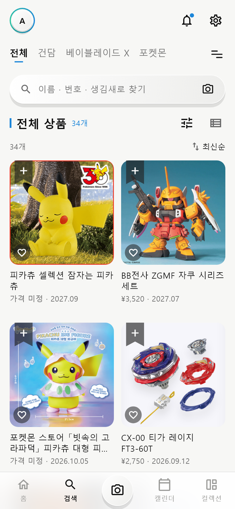

# 셀프 논증 기록 (제출물 ① 저장소 `docs/` · 20점)

> 1인 과제이므로 "협업" 대신 **스스로 논증**합니다. 내 설계 결정마다 **AI를 반론자로 세워** 약점을 공격받고, 다시 반박하거나 고쳐서 결론을 냅니다.
> 구조(쟁점마다): **내 주장 → 반론(AI · 나) → 재반론 · 수정 → 결론(유지 · 수정 · 폐기) → 근거(원칙 P번호 · 리뷰) → 전 · 후 화면**
> 이론: Toulmin 논증 모형(1958, *The Uses of Argument*) — 주장 · 근거 · 보증 · **반론**.
> 증거: `docs/prompt-log.md` ★ 줄(AI에게 반론을 요청한 기록) · `docs/원칙카드.md` P번호 · 커밋. 전 · 후 = 그 쟁점을 고친 커밋의 바로 앞 · 뒤(`git show <커밋>`으로 확인).
>
> ⚠ **초안**: 아래 표는 10/24–10/26 실제 대화 기록(★ 두 번: ChatGPT 현행 UI 비판 · Claude Code "UI 설계 문제 지적" 요청)에서 옮겨 적은 것입니다. 내 주장 · 재반론 칸이 내 생각과 같은지 확인하고 고친 뒤 이 줄을 지웁니다.

작성자: TODO(이니셜) · 사용한 AI 도구: Claude Code(구현 · 반론) · ChatGPT(현행 UI 비판)

## 쟁점 목록

| # | 쟁점 (화면 · 요소 번호) | 내 주장 | 반론 (AI · 나) | 재반론 · 수정 | 결론 | 근거 (원칙 P번호 · 리뷰) | 전 · 후 화면 | 증거 (prompt-log · 원칙 카드) |
|---|---|---|---|---|---|---|---|---|
| 1 | 좋아요 · 구매함을 어떤 모양으로 누르게 할까 (A-9 · G-4b · D-6) | 화면마다 그 자리에 맞는 모양이 좋다 — 사진 위엔 리본 · 하트, 도감 칸엔 작은 동그라미, 상세엔 큰 버튼 | (AI) 같은 "구매함"이 리본 · ✓원 · 동그라미 3–4가지 모양이라 일관성 위반, 교수가 바로 지적할 곳 — P04 | 자리 · 크기는 화면마다 달라도 되지만 **모양은 하나**: ♡ = 좋아요, 리본 + → ✓ = 구매함. 도감 동그라미 버튼 삭제, 상세 버튼도 리본 아이콘 | **수정** | P04 · 2023-11-23 ★5 "쇼케이스와 컬렉션 차이를 모르겠다" | 전 `132c398`(도감 동그라미 ♡ +) → 후 `b29785b`(모두 리본 · ♡) · `04_v2_c.png` | prompt-log 10/25 ★ "UI 설계 문제" · 원칙 카드 P04 |
| 2 | 포인트 색을 몇 개 쓸까 (S-15) | 흑백 + 하늘색 하나로 절제해야 고급스럽다 | (AI) 고름 · 좋아요 · 구매함 · 안 읽음 · Lv · 링크가 모두 같은 파랑이라 "원하는 것"과 "가진 것"이 색으로 구분되지 않는다 — P04 · P01 | 색은 두 개로만: 파랑 = 고름 · 좋아요, 민트 = 가진 것(구매함 · 인증 · 수집 막대). 흑백 절제는 유지 | **수정** | P04 · P01 | 전 `132c398` → 후 `b29785b` · `02_v2_a.png`(리본 ✓ 민트) | prompt-log 10/25 ★ · 원칙 카드 P04 |
| 3 | 위쪽 머리(아바타 줄 · 채널 바 · 검색창)를 늘 보일까 (S-13) | 늘 보여야 내 채널 · 검색을 외우지 않는다 — P06 | (AI) 머리가 약 170px로 네 탭 모두 같고, 탭 바는 스크롤하면 숨는데 머리는 안 숨어 내용이 좁다 — P08 | 재인(P06)과 미니멀(P08)을 둘 다: 아래로 읽을 때만 아바타 줄을 접고, 위로 올리면 다시 — 채널 바 · 검색창은 남김 | **수정**(절충) | P08 · P06 · 2023-04-18 ★5 "the layout is a pain" | 전 `a342bf5` → 후 `f44c7ef` | prompt-log 10/25 ★ · 원칙 카드 P08 |
| 4 | 저장을 못 하니 화면마다 따로 바뀌어도 될까 (S-16) | 저장 금지 규칙이라 각 화면의 setState 로 충분하다 | (AI) 홈에서 ♡ 를 눌러도 컬렉션 · 내 정보 숫자가 그대로라 발표 데모에서 바로 어긋남이 보인다 — P04 · P01 | 저장이 아니라 **메모리 안의 한 벌**은 규칙 위반이 아니다: 맨 위 setState + InheritedWidget(패키지 없음). 도감 칸 · 게시물 숨김은 화면 안으로 남기고 한계로 밝힘 | **수정** | P04 · P01 · AGENTS.md "setState 만 · 상태관리 패키지 금지" | 전 `f44c7ef` → 후 `a4d4f4d` · `12_collection.png` | prompt-log 10/26 · 원칙 카드 P04 |
| 5 | 가짜 기능을 토스트로 "프로토타입이라…"라고 알릴까 (K-3 · D-14 · I-3 …) | 가짜인 것을 정직하게 알려야 한다 — P10 | (AI) 연달아 뜨면 미완성처럼 보이고 시연을 끊는다 — P08 | 정직성은 **문서 · 발표**에서 지킨다(디자인 가이드 4장 "가짜 기능은 가짜라고"). 화면 문구는 앱처럼: "백업 파일을 만들었어요" 등 | **수정** | P08 · P10 | 전 `f7ed455` → 후 `132c398` | prompt-log 10/25 ★ · 디자인 가이드 4장 |
| 6 | 전체 목록은 어떻게 거를까 (O-2) | (AI 초안) 좋아요 · 구매함 상태 알약으로 거른다 | (나) 상태가 아니라 **작품별**로 봐야 하고, 알약 줄은 못생겼다 — 쇼핑 앱처럼 오른쪽 필터 패널 | 오른쪽 패널(작품 · 종류 · 라인 · 가격 · 발매), 고르는 동안 개수가 다른 조건을 따라 바뀜 | **수정** | P06 · P08 | 전 `d8dd566` → 후 `23dc963` · `10_search_all.png` | prompt-log 10/25 "홈 › 전체 목록" · 원칙 카드 P06 |
| 7 | 홈을 무엇으로 채울까 (A) | 기존 Gunpula 홈 구성(버전 · 총 개수 · IP 입구 카드)을 그대로 옮긴다 | (ChatGPT) 기존 화면의 문제 지적 — **원문을 prompt-log 에 붙이고 이 칸을 그 내용으로 고칠 것(TODO)** | 홈 = 내 채널의 새 소식만: 공식 예고 배너 + 최근 추가 · 이번 달 발매 · 공식 예고 · 최근 본 가로 줄 | **수정** | P08 · P06 · 2023-11-23 "익히기 어렵다" | 전 `p04 10/24`(카탈로그) → 후 `10/25 15:43` · `02_v2_a.png` | prompt-log 10/24 ★ (ChatGPT) · 원칙 카드 P08 |

- **결론**: 유지(반론을 반박하고 그대로 — 반박 근거 필요) · 수정(반론을 받아 고침) · 폐기(주장을 버림 — 왜).
- 쟁점 7: ChatGPT 답 원문을 찾아 prompt-log 10/24 ★ 줄에 붙이고 반론 칸을 그 내용으로 바꾼다(TODO).

## 전 · 후 화면

| 쟁점 | 전 | 후 |
|---|---|---|
| 현행 → v2 |  |  |
| 1 · 2 표시 모양 · 색 | (커밋 `132c398` — 도감 칸 동그라미 ♡ +, 리본 ✓ 파랑) |  |
| 6 거르기 | (커밋 `d8dd566` — 작품 알약 줄) |  |

- 전 화면은 해당 커밋을 받아 실행하면 볼 수 있다: `git checkout 132c398 && flutter run -d chrome` (본 뒤 `git checkout main`).
